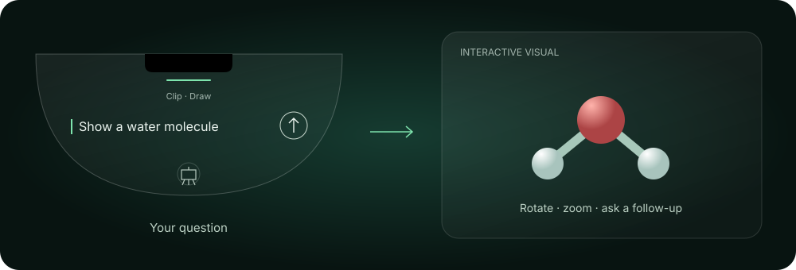

# Clip

**Ask it. See it.** A macOS notch assistant that turns questions into interactive 3D scenes, diagrams, and live HTML.



### Try Draw

1. Hover over the green line for one second, or press **Control–Option–Space**.
2. Click the easel, type a request, and press **Return**.
3. Rotate and zoom a 3D scene, or interact with the HTML explanation. **Continue** starts a voice follow-up with pointer sharing.

Try **“Explain how an airplane flies in 3D”**, **“Show a water molecule”**, or **“Make an interactive question-and-answer quiz about fractions.”** Draw chooses 3D or HTML; you can request either explicitly. Scenes use supported primitives and diagrams, rather than arbitrary photorealistic meshes.

### Run locally

Requires macOS 14.2+, Xcode Command Line Tools, and Node.js 22+.

```sh
npm ci
npm run desktop:build
open build/Clip.app
```

For **OpenAI Draw, Decisions, Talk and spoken replies**, copy `.env.example` to `.env.local` and set your own `OPENAI_API_KEY` there. Chat uses your signed-in Codex or Claude CLI; Claude Draw uses Claude's CLI. Your API key and accounts are never included. See [setup and controls](desktop/README.md) for authentication, permissions and shortcuts.

### Also included

Text chat · Codex / Claude / Auto / Both · selected-text editing · screenshots · live voice · red pointer sharing · matching spoken and written replies. All remain available in the public app. See [feature details and data flow](docs/FEATURES.md).

### Recording a public demo

Quit the existing Clip instance, then launch:

```sh
open build/Clip.app --args --public-demo
```

This hides optional personal habits and their menu items, even when enabled on your Mac. A normal relaunch restores them. It does not erase your progress or hide other apps' content; use a clean desktop and non-sensitive prompts when recording.

### Private local options

Habits are **off by default**. Anyone can opt in with seven goals of their own using [local settings](docs/LOCAL-FEATURES.md). Names, completions and history stay on that Mac. The public source includes only a disabled generic example.

### Development

```sh
npm test
npm run check
bash scripts/test-island-layout.sh
```

Use feature branches and pull requests; see [AGENTS.md](AGENTS.md). This is an independent implementation inspired by HeyClicky, with [written research notes](research/AI-BOUNDARIES.md); original binaries and raw evidence are not distributed.

MIT licensed; installed dependencies retain their own licenses. The included wake tone was [generated with ElevenLabs](desktop/Resources/wake-chime.md).
