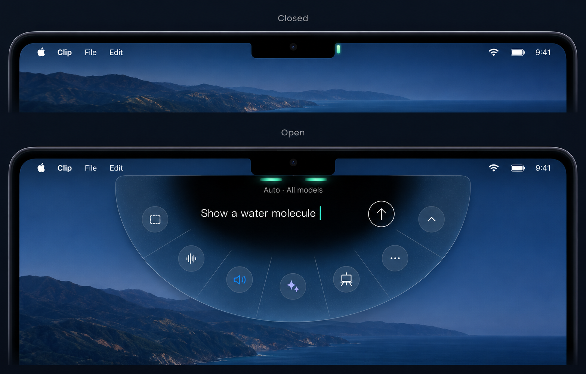

# Clip



**An AI assistant in your Mac’s notch.**

- **Ask** questions by typing or talking.
- **Share a screenshot** so Clip can explain what you’re looking at.
- **See the answer** as live 3D, a diagram, or interactive HTML over your desktop.
- **Keep exploring:** rotate, zoom, or follow up by voice while pointing.

## Install

macOS 14.2+ · Node.js 22+ · Xcode Command Line Tools

```sh
git clone https://github.com/diegocp01/clip_ai.git
cd clip_ai
npm ci
cp .env.example .env.local
```

Add your OpenAI API key to `.env.local`, then:

```sh
npm run desktop:build
open build/Clip.app
```

OpenAI features use your API billing. Text chat also supports signed-in Codex or Claude accounts. [Setup, permissions and shortcuts →](desktop/README.md)

## Try it

Hover over the green line for **1 second**, or press **Control–Option–Space**. Type **“Show me how an airplane works in 3D”** and press **Return**. Rotate or zoom the result; **Continue** starts a voice follow-up with pointer sharing.

## How it works

**Question → choose a format → stream the visual → explore it.**

- **[Decisions API](https://developers.openai.com/api/docs/guides/decisions) · GPT-6 Luna:** choose text or a visual, then 3D or HTML.
- **[Responses API](https://developers.openai.com/api/docs/guides/text) · GPT-6.1 Sol, Low, [Ultrafast](https://developers.openai.com/api/docs/guides/ultrafast-mode):** stream the visual data as it’s generated.
- **Three.js / SVG / HTML:** render it over your desktop.

Draw models and effort remain adjustable. Scenes use supported 3D primitives and diagrams. [Feature details →](docs/FEATURES.md)

[Private local options](docs/LOCAL-FEATURES.md) · [Development](AGENTS.md) · [MIT license](LICENSE)
