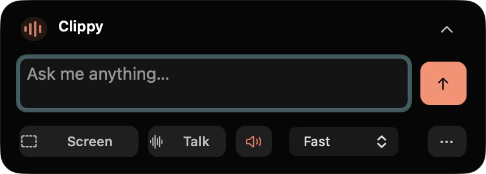

# Clip

A local Mac assistant that lives at the top of the screen and places interactive visuals over your desktop. Text editing uses the Codex SDK; streaming visuals use the bundled Codex app-server with your existing ChatGPT login.



This is a separately implemented app inspired by the HeyClicky demo. It does not install HeyClicky, call its backend, reuse its credentials, or ship its drawing code.

## Quick guide and web UI

Open `/guide.html` on the running local server for a short visual introduction and three manual tests. The browser workspace and floating visual overlay use a dark glass style inspired by [AI Battle Tic-Tac-Toe](https://github.com/diegocp01/ai_battle_tic_tac_toe): translucent surfaces, bright edges, system typography, and blue controls. Reduced transparency, increased contrast, and unsupported backdrop filters use more opaque surfaces. The overlay background remains transparent; glass blur inside WebKit is not a guarantee of native macOS desktop refraction.

The native notch, composer, and captions are separate and are not styled by these web stylesheets.

## Open the app

Requires macOS 14.2+, Node.js 22 or later, and Xcode Command Line Tools (for Swift).

```sh
npm ci
npx codex login
npm run desktop:build
open build/Clip.app
```

The primary interface is the black island at the top of your display. Rest the pointer on it for 1 second to open it; click the top-right chevron or press Escape to collapse it. The earlier browser interface at `http://127.0.0.1:4317/` remains only a development harness.

Use the island to ask a question, dictate on-device, or attach one screenshot. Select text in another app and press Control-Option-D to proofread or Control-D to rewrite; both use the selected model (GPT-6.1 Sol or Claude Sonnet 5.5, each at high effort) and replace the selection automatically. Generated 3D objects and diagrams appear in a transparent floating overlay above your other apps. Select a labeled part to ask a follow-up. See [desktop/README.md](desktop/README.md) for shortcuts and controls.

Sign in with ChatGPT using the bundled Codex CLI. Your account needs access to `gpt-6.1-terra` for visuals and `gpt-6.1-sol` for text editing. Codex visuals and text editing use your ChatGPT login. Realtime voice and contextual loading labels use a separate OpenAI API key and API billing.

## What uses AI

Typed and dictated questions, explicitly attached images, prior answers and the previous scene are sent to Codex. Codex generates validated scene data rather than host-executable JavaScript. Complete visual parts appear progressively as the response streams; the final answer is committed only after full validation. The app renders 3D primitives with Three.js and diagrams with SVG. Optional local dictation uses on-device recognition. Talk uses GPT-Realtime-2.1 over WebRTC for streaming speech, turn detection and interruptions; the speaker button mutes replies. Audio is sent to OpenAI only after you start Talk. End, Escape or Quit stops the microphone. Typed replies can still use installed system voices.

Each model turn uses a read-only, tool-disabled, ephemeral Codex session. Personal Codex configuration, tools and environment API keys are excluded. Screenshots are temporarily written for Codex image input, then removed. Streaming requests use a temporary Codex home linked only to the existing file-based login, with personal configuration excluded; the temporary home is removed after the request. Conversation context is held in the running client, not a project chat database. The Codex service processes prompts and images; this is not offline inference.

## Automatic selected-text editing

Open the notch while text is selected in another app: Decisions chooses **Proofread** for minimal corrections or **Rewrite** for wording that clearly needs better flow, then the existing editing provider performs the edit. No prompt is required. Selection editing takes priority over Draw/chat on opening; no personal-preference history is inferred. Only the selected text (up to 12,000 characters) is sent to Decisions and the editing model, not the rest of the document or clipboard. Missing Decisions access, refusal, invalid choices, or a 2.5-second timeout defaults to proofreading.

Clip leaves keyboard focus with the original app. An unchanged, writable selection is replaced using normal Paste with Undo; a changed or read-only selection gets a copyable result instead. The clipboard is restored unless it changed in the meantime. Close the notch or click Cancel to stop. Reopening the same unchanged selection does not repeatedly edit it. Secure/unsupported fields and missing Accessibility permission do not trigger an edit or a permission prompt. Existing manual proofreading/rewriting shortcuts still work.

## Automatic visual or text answers

Normal Send/Return lets Decisions choose **Draw** or **text**. Visual creation requests go straight to Draw: “Create a hyperrealistic fighter jet above the clouds” requests a 3D representation, and “How do molecules work?” can also benefit from a visual. Realistic/cinematic styling does not turn a visual request into chat; the renderer still produces a simplified supported model, not a photograph. “Hi”, image-prompt writing, drawing instructions, and explicit text-only requests stay text. The decision uses the submitted prompt and an attachment-presence flag, never screenshot bytes, history, or selected text. This prompt-format route does not rewrite selections or trigger computer actions. Opening Clip with selected text uses the separate automatic editing route below. A missing key, timeout (2.5 seconds), refusal, or invalid answer defaults to text. Stop cancels the choice before generation. Draw uses its independent model/effort; text uses your manual chat settings or the Auto model router below. Explicit Draw, voice, and visual-overlay follow-ups keep their existing paths. Decisions is a model judgment, so it can choose an unhelpful format; the Draw button remains a direct override. To run the opt-in live routing regression cases, use `node scripts/eval-presentation.mjs` with the existing local API key configured. It makes 15 billed Decisions calls; normal tests and CI remain offline.

## Auto chat models

**Auto is the default chat selection.** Hover or click the native model caption to choose a specific model; explicit choices persist across launches. Send/Return first asks Decisions whether a visual would materially help explain the submitted question. A visual uses independent **Draw settings**; a text answer uses your chat settings (including Auto model selection). The easel always requests Draw. Existing manual selections are copied once into chat preferences; selecting Auto or changing chat models never changes Draw or Realtime voice. Visual-overlay follow-ups keep the mode of the request that created their result. The bottom selector sets the routing scope: Codex, Claude, Auto (all four models), or Both for comparisons. With Codex or Claude selected, the top menu lists only that provider’s models plus Auto. Provider Auto keeps its mascot and routes only within that provider’s two eligible models. Bottom Auto shows sparkles and routes across all four. Each provider remembers its own Auto/manual preference. Both keeps explicit per-provider model settings.

For every Auto chat prompt, within the selected provider scope, OpenAI Decisions (`gpt-6-luna`) chooses one model/effort pair from GPT-6 Astra, GPT-6.1 Terra, Claude Opus 5.5, and Claude Sonnet 5.5. All supported levels are offered: GPT low/medium/high/xhigh/max/ultra; Claude low/medium/high/xhigh/max. The picker shows **Reasoning: Auto (Decisions)** instead of manual effort controls. The caption shows the chosen model and effort when a route arrives. Decisions sees the submitted prompt and an image-presence flag, not image bytes or history. Routing quality is model judgment, not a guarantee of the best answer.

Auto uses the existing server-side API key and separate API billing, then the chosen signed-in Codex or Claude CLI produces the answer. Routing has a six-second deadline. Missing credentials, refusal, invalid routes, or unavailable provider sign-in fail visibly without silently choosing another model or reducing effort. Stop/disconnect cancels routing before inference. Existing tool restrictions remain in force, and provider/account policy can still reject a requested model or effort; the app does not claim independently verified delivered reasoning depth. Chat returns text; Draw continues creating visuals, and Talk continues using its existing Realtime model and independent drawing settings.

## Contextual loading labels

For composer requests (GPT or Claude), [OpenAI Decisions](https://developers.openai.com/api/docs/guides/decisions) with `gpt-6-luna` chooses a short activity label: “hi” → “Replying…”, a visual request → “Drawing…”, or a rewrite → “Rewriting…”. It receives only the submitted prompt and whether an image is attached; screenshot contents, conversation history, and the previous scene are not sent to Decisions. The existing ignored `.env.local` API key is used server-side. This is separately billed API usage, including when Claude answers.

Generation starts immediately with “Thinking…” while label selection runs in parallel. Missing credentials, refusal, invalid output, or a 2.5-second timeout keep the neutral label. Completion, cancellation, and disconnect abort the label request; late responses cannot replace the final state. These decisions choose display copy only: they do not route requests, choose models, or control animations. Selected-text edit shortcuts keep their existing explicit action labels. The native speaking waveform is white.

## Live voice

Save `OPENAI_API_KEY` in a local `.env.local` file (ignored by Git). Never commit this file or put the key in browser code. The server reads the credential; WebKit receives only the WebRTC connection answer.

Click **Talk**, grant macOS microphone access, then speak naturally. Click **End** to stop. Ask “How do molecules work?” and the voice can proactively show a labeled visual while explaining it; you do not have to say “draw.” Greetings and explicit “voice only/no drawing” requests stay verbal. The voice waits for a successful tool result before referring to a visible drawing, and explains verbally if drawing fails. Say “Draw a water molecule” to explicitly delegate a visual to the selected model: Codex or the Claude CLI using your independent Draw model and effort settings. The voice itself always uses OpenAI's Realtime API. Click **Screen** during Talk to share one screenshot, or let the voice request one when your question needs the currently visible screen. The native composer shows **Screenshot captured**. Voice does not continuously watch your screen. The speaker button mutes spoken replies without ending microphone capture; use End to stop listening. Sessions end after 10 minutes and can be restarted. The … menu keeps optional on-device dictation separate.

API credential, session configuration and native connection to the Listening state have been verified. Spoken playback, interruption and voice-to-drawing behavior still need a user conversation test. Microphone access is under System Settings → Privacy & Security → Microphone → Clip. Screenshot access is under Screen & System Audio Recording in the same settings section.

## Speed and cost

Model: `gpt-6.1-terra`. Low reasoning and Fast mode are the defaults. Standard and Fast are explicit requested tiers, with no silent model/tier fallback. Access and billing follow your Codex account. The SDK does not make inference free or unlimited. A successful request does not expose independent proof of the server's delivered service tier.

The installed SDK emits completed agent messages, so visual generation uses the app-server `item/agentMessage/delta` stream. This uses the same bundled CLI and login, without a separate inference API key. Every completed part is schema-validated before rendering; errors or cancellation restore the last completed visual.

Official references: [Codex app-server](https://learn.chatgpt.com/docs/app-server), [Codex SDK](https://learn.chatgpt.com/docs/codex-sdk), [speed and eligibility](https://learn.chatgpt.com/docs/agent-configuration/speed).

## Checks and evidence

`npm test` covers schema validation, SDK request configuration, temporary image cleanup, API-key exclusion, local HTTP access restrictions, and cancellation. `npm run check` checks JavaScript syntax. `npm run smoke` makes a real small model request and saves a receipt under `research/evidence`.

[Static investigation](research/AI-BOUNDARIES.md) records the REA findings and limitations. It found separate agent, conversation, drawing and speech interfaces; a one-line provider replacement would not recreate the app. HeyClicky was downloaded and inspected without installing or launching it. Raw evidence, extracted code and original binaries are local-only and are not distributed in this repository. The written summaries reference those excluded artifacts.

## Current limits

The original demo's arbitrary generated programs, detailed bespoke 3D meshes, computer control and connected services are not reproduced. Live audio is implemented separately from visual generation. This version uses bounded primitive scenes and diagrams. Visual parts now appear while Codex generates them; the initial wait still depends on Codex. Voice and visual generation are not frame-synchronized, and demo-equivalent latency is not guaranteed. Dictation and screen capture require your OS permissions on first use. No routine, login item or background installation is created.

Clip uses the Codex CLI bundled with its SDK (0.166.0) for current model support, reusing your existing ChatGPT login. It does not update the globally installed CLI.

## Contributing

After the initial bootstrap, changes go through feature branches and pull requests. CI runs the JavaScript checks and tests without credentials; native builds and permission-dependent behavior need macOS verification. See [AGENTS.md](AGENTS.md).

### Automatic screen context

After a native Send or Draw prompt, Decisions checks whether it needs the currently visible app, error, page or chart. “What is wrong with this error on my screen?” can capture one screenshot; “How do molecules work?” does not. The decision receives only the submitted prompt. An existing screenshot is reused, and explicit requests not to capture are respected. Missing API access, timeouts or uncertain decisions skip capture.

The native semicircle shows **Screenshot captured** below the prompt (or **Screenshot unavailable** if capture fails). Clip hides its panels during capture and uses the main display. Automatic capture requires existing Screen Recording access; use the Screen circle once to request it if needed. Images are sent to the selected answer/drawing provider (both Codex and Claude when Both is selected), or OpenAI Realtime during Talk. Typed automatic captures apply to that request; voice retains shared screen context until End. Temporary capture files are deleted immediately.

Talk exposes a bounded `capture_screen` tool: one capture per spoken turn, at most eight per session. If the voice requests capture and Draw together, capture finishes first so Draw gets the image. End aborts pending sharing; Stop cancels typed preflight/capture delivery. The text/drawing models remain tool-disabled: their screen context comes from Decisions preflight, while Realtime explicitly calls the native capture tool.

### Codex, Claude, or Both

The native provider circle opens a three-option dropdown. **Both** sends the same prompt and optional screenshot concurrently to Codex and Claude and displays separate text answers with Copy buttons. One provider can finish even if the other fails; Stop cancels both. Chat models and reasoning effort can be configured separately in the caption menu. Both bypasses automatic visual routing and never creates drawings or voice output. Draw and Talk retain their independent single-provider settings.

With Both selected, selected-text proofreading/rewriting also returns two copyable suggestions, leaving the original text untouched. Automatic editing chooses the same action once before comparing the existing editing models. Comparison calls do not share provider outputs or include prior conversation history. `/api/compare` requires the local session, validates text/image and model input, rejects Draw/voice requests, and reserves two inference slots for cancellation and concurrency control.

### Matching speech and text

Typed replies use one complete string for the native reply bubble, Copy, and speech synthesis. The former 500-character/three-line caption clipping is removed; longer answers scroll inside a minimal floating frosted bubble. Small Copy and Dismiss icons sit beside the text, with no header. Both comparisons use two compact, labeled bubbles with independent copy controls and content-sized height.

Talk displays the actual Realtime audio transcript, including final transcript corrections, rather than Draw’s separately generated explanation. New turns and interruptions clear the old transcript; stale events cannot overwrite a newer reply. Captions are not word-timed: the Realtime transcript can arrive before the corresponding audio plays. Interrupted audio has no exact word-aligned transcript, so Clip clears that bubble instead of presenting the unplayed ending. Draw explanations remain available as visual content without replacing the spoken transcript.

### Point & Share in Talk

During Talk, the bottom-center circle becomes a custom pointer control. Enable it to show a red comet/trail and share cropped snapshots around your pointer with Realtime while you speak. It is opt-in for each session; click again or end Talk to stop. Motion is sampled locally, crops are rate-limited, and only the latest three pointer images remain in conversation context. This is focused snapshot sharing, not a video recording. See [desktop verification and limits](desktop/README.md#point--share-during-talk).
