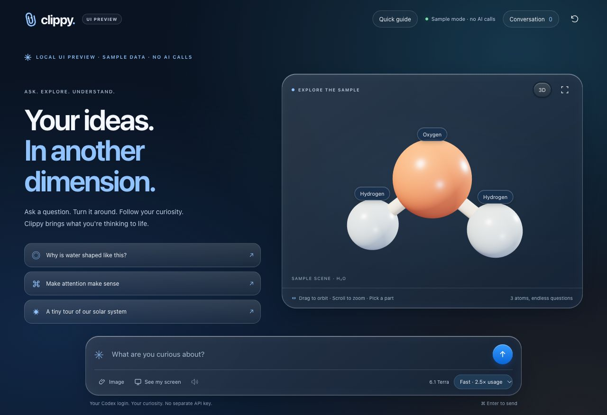
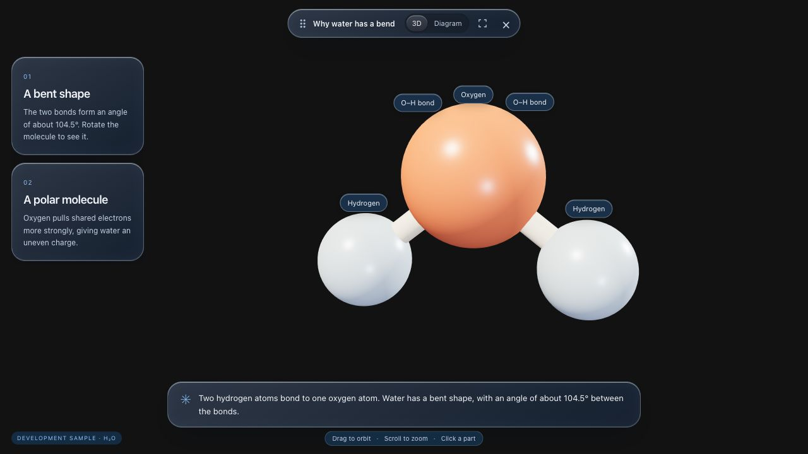

# Web UI review

## Scope

Dark glass styling for the browser workspace and the WebKit visual overlay: toolbar, generated explanation cards, diagrams, part details, web captions, composer, history, progress, and errors. Inspired by the glass surfaces in [AI Battle Tic-Tac-Toe](https://github.com/diegocp01/ai_battle_tic_tac_toe/blob/db223fd3c3c692e693d7a936116aa188712b5f40/static/css/style.css). The shared styles include prefixed WebKit backdrop filters, opaque fallbacks, reduced-motion and reduced-transparency support, high-contrast colors, and visible keyboard focus.

No files in `desktop/`, notch positioning, native composer controls, native captions, or server behavior are changed. No app reinstall is included. The standalone `/guide.html` explains the app and offers three manual tests; its checklist does not run those tests.

## Verified

- `npm test`: 25 passed. `npm run check` and `git diff --check` passed.
- In-app browser, 1280 × 720 and 390 × 844: workspace layout, no horizontal page overflow, composer below content.
- Sample-only injected server: request/progress/result, generated cards, 3D and diagram switching, 3D part selection, keyboard diagram selection, history, error with preserved prompt, cancellation, and reset.
- Floating overlay: 3D and diagram views, cards, part details; transparent body and `pointer-events: none` on the overlay root. Narrow layouts inspected; glass and controls fit.
- Guide: checklist count updates and resets; Copy prompt reports success.
- Browser console: no errors or warnings during the inspected flows.

Screenshots use labeled sample data, not live model output:

## Manual check after integration

1. Start the app's server from this checkout. Open `/guide.html` or `/` to inspect the browser UI.
2. In the native app, request a labeled water molecule, click a label, reset the view, and dismiss it. Check that the desktop between controls still receives clicks.
3. Request a diagram and a response with cards. Check typography and contrast over both light and dark desktop backgrounds.
4. Check macOS reduced transparency and higher contrast, where supported by WebKit.

The installed native app and permission-dependent flows were not exercised with this branch. Native WebKit compositing can differ from the browser preview; CSS glass does not claim system Liquid Glass refraction of the desktop behind the window. No live AI request or microphone/screen-capture access was used for UI verification.
